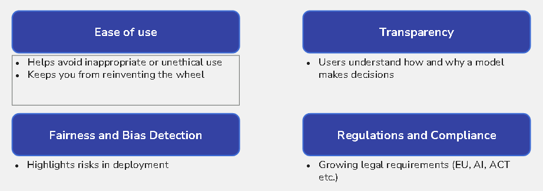

# Deep Learning Toolkits in Practice

**Session Time:** 120 minutes

---

## Table of Contents

1. Introduction to Deep Learning Frameworks
2. Deep Dive into PyTorch
3. Compute and Memory Management in Deep Learning
4. Cost, Security, and Legal Considerations
5. Connecting Toolkits to the Data Science Workflow
6. Exploring torchvision and Pre-trained Models
7. Introduction to Hugging Face and Transformers
8. Fine-Tuning Pre-Trained Models
9. Lab: Pre-Trained Power-Up — Image Classification
10. Wrap-Up and Reflection
11. Resources

---

## Learning Objectives

By the end of this module, you'll be able to:

1. Identify key deep learning frameworks and their practical applications.
2. Use **PyTorch** to build, train, and evaluate neural network models, demonstrating a deeper understanding of its core components.
3. Manage compute resources (CPU vs. GPU) and memory efficiently during model training.
4. Evaluate the cost, security, privacy, and legal implications of using pre-trained models.
5. Connect deep learning toolkits to specific stages of the data science workflow.
6. Work with **torchvision** and **Hugging Face Transformers** for transfer learning tasks.
7. Fine-tune a pre-trained model and evaluate its performance against a model trained from scratch.

---

## Session Breakdown

| Segment | Topic | Duration |
| :--- | :--- | :--- |
| 1 | Introduction to Deep Learning Frameworks | 10 min |
| 2 | Deep Dive into PyTorch | 25 min |
| 3 | Compute, Cost, and Security Considerations | 20 min |
| 4 | Connecting Toolkits to Workflow | 10 min |
| 5 | torchvision and Hugging Face | 20 min |
| 6 | Fine-Tuning Pre-Trained Models | 15 min |
| 7 | Lab: Pre-Trained Power-Up | 15 min |
| 8 | Wrap-Up and Reflection | 5 min |

---

### 1. Introduction to Deep Learning Frameworks

Deep learning frameworks provide the high-level building blocks for designing, training, and validating neural networks. They abstract complex mathematical operations into accessible functions.

**Popular Frameworks Comparison**

| Framework | Primary Language | Best For | Key Feature |
| :--- | :--- | :--- | :--- |
| **PyTorch** | Python | Research, Prototyping, Production | Dynamic computation graphs (eager execution) |
| **TensorFlow** | Python | Production at Scale, Mobile/Edge | Static graphs (originally), TF Serving, TFX |
| **JAX** | Python | High-Performance Research | Autograd and XLA (Accelerated Linear Algebra) |

---

### 2. Deep Dive into PyTorch

PyTorch is a dominant framework in both research and industry due to its flexibility and Pythonic nature.

#### Core Components

* **torch.Tensor**: The fundamental data structure, similar to NumPy arrays but with GPU support and automatic differentiation capabilities.
* **torch.autograd**: PyTorch’s automatic differentiation engine that powers neural network training. It records operations on tensors to form a computation graph, allowing for efficient backpropagation.
* **torch.nn**: The neural network library containing predefined layers (Linear, Conv2d, LSTM), loss functions (MSELoss, CrossEntropyLoss), and container classes (Sequential, Module).
* **torch.optim**: Implements various optimization algorithms like SGD (Stochastic Gradient Descent), Adam, and RMSprop.
* **torch.utils.data**: Provides tools for data loading and preprocessing, including `Dataset` (stores samples and labels) and `DataLoader` (iterates over data in batches).

#### The PyTorch Training Loop Anatomy

A standard training loop in PyTorch consists of explicit steps, giving developers granular control:

1.  **Forward Pass**: Pass input data through the model to get predictions.
2.  **Compute Loss**: Calculate the difference between predictions and actual targets using a loss function.
3.  **Backward Pass**: Call `loss.backward()` to compute gradients of the loss with respect to model parameters.
4.  **Optimization Step**: Call `optimizer.step()` to update parameters based on computed gradients.
5.  **Zero Gradients**: Call `optimizer.zero_grad()` to clear old gradients before the next iteration.

**Code Example: A Complete Training Step**

```python
import torch
import torch.nn as nn
import torch.optim as optim

# 1. Define Model, Loss, and Optimizer
model = nn.Linear(10, 1) # Simple linear regression model
criterion = nn.MSELoss()
optimizer = optim.SGD(model.parameters(), lr=0.01)

# Dummy data
inputs = torch.randn(5, 10)
targets = torch.randn(5, 1)

# 2. Training Loop Step
optimizer.zero_grad()       # Clear previous gradients
outputs = model(inputs)     # Forward pass
loss = criterion(outputs, targets) # Compute loss
loss.backward()             # Backward pass (compute gradients)
optimizer.step()            # Update model parameters

print("Loss:", loss.item())
```

### 3. Compute, Memory, and Cost Management

Deep learning models are computationally expensive. Managing resources is a critical skill.

**Compute: CPU vs. GPU**

* **CPU (Central Processing Unit)**: Good for sequential tasks and general-purpose computing. It is slow for the massive parallel matrix multiplications required by neural networks.
* **GPU (Graphics Processing Unit)**: Contains thousands of cores designed for parallel computations, making it ideal for deep learning. Training on a GPU can be 10x-100x faster than on a CPU.
* **Recommendation: Use Google Colab**: Google Colab provides free access to basic GPUs (like the NVIDIA T4). This is the best way to learn without requiring expensive hardware. You can select a GPU by navigating to `Runtime -> Change runtime type`.

**Using GPUs in PyTorch**

```python
# 1. Check for GPU availability and set the device
device = "cuda" if torch.cuda.is_available() else "cpu"
print(f"Using {device} device")

# 2. Move your model to the device
model.to(device)

# 3. Move your data (tensors) to the device in the training loop
for inputs, labels in dataloader:
    inputs, labels = inputs.to(device), labels.to(device)
    
    # ... (rest of training loop) ...
```

**Memory Maintenance**

* **`OutOfMemoryError`**: This is a common error on GPUs. It means your model and data batch are too large for the GPU's VRAM.
* **Solution 1: Reduce Batch Size**: In your `DataLoader`, use a smaller `batch_size`. This is the most common fix.
* **Solution 2: Use `torch.no_grad()`**: During evaluation or inference (when you are not training), wrap your code in `with torch.no_grad():`. This tells PyTorch not to store gradients, saving significant memory.

**Cost**

* **Training Cost**: Training large models can take days or weeks on expensive cloud GPUs (like NVIDIA A100s or H100s), costing thousands of dollars.
* **Inference Cost**: Deploying a model also has costs. A model serving predictions 24/7 requires a running server (often with a GPU).
* **The Value of Pre-trained Models**: Using a pre-trained model (see next sections) and fine-tuning it can reduce training time from weeks to hours, drastically cutting compute costs.

---

### 4. Security, Privacy, and Legal Considerations

Using pre-trained models is not just a technical decision; it has significant non-technical implications.

* **Data Security & Privacy**:
    * **Model Memorization**: Large models can sometimes "memorize" and regurgitate sensitive data (like names, social security numbers, or private code) from their training sets.
    * **Data Poisoning**: An attacker could "poison" the training data of an open-source model, inserting backdoors or biases that you inherit.
* **Legal & Ethical Considerations**:
    * **Licensing**: Pre-trained models come with licenses. A model with a "non-commercial" license (like some LLaMA versions) cannot be legally used in a commercial product. Always check the license (e.g., MIT, Apache 2.0).
    * **Inherited Bias**: Models trained on broad internet data inherit societal biases (e.g., related to race, gender, or culture). Using such a model for tasks like resume screening or loan applications without a thorough bias audit can lead to harmful and illegal outcomes.

---

### 5. Connecting Toolkits to the Data Science Workflow

These advanced toolkits are not separate from the data science workflow; they are the specialized tools required for the "Modeling" phase when dealing with complex data.

| Workflow Stage | Task Example | Tooling Required |
| :--- | :--- | :--- |
| **Problem Definition** | "We need to classify customer support emails into 10 categories." | (Standard DS) |
| **Data Preparation** | **Tokenize text**, resize images, apply data augmentation. | Hugging Face `tokenizers`, `torchvision.transforms` |
| **Modeling** | Build and train a text classifier or an image classifier. | `torch.nn`, `torch.optim`, `transformers.AutoModel` |
| **Evaluation** | Check model accuracy on a test set. | `sklearn.metrics`, `evaluate` (Hugging Face) |
| **Deployment** | Serve the model as a production API. | PyTorch `torch.jit`, Hugging Face `pipeline`, Vertex AI |

**When to use these tools:**
* When your data is **unstructured** (text, images, audio).
* When the patterns are too complex for classical ML (e.g., understanding syntax, identifying objects in varied scenes).
* When performance is paramount and a pre-trained model provides a state-of-the-art starting point.

---

### 6. Exploring torchvision and Pre-trained Models

`torchvision` simplifies computer vision workflows by providing:
- Pre-loaded datasets (MNIST, CIFAR-10, ImageNet)
- Data augmentation and preprocessing utilities (torchvision.transforms)
- Pre-trained models (ResNet, VGG, MobileNet)

**Using Pre-Trained Models**
```python
from torchvision import models
# Load a ResNet18 model that was pre-trained on the ImageNet dataset
model = models.resnet18(weights=models.ResNet18_Weights.DEFAULT)
```
---

### 7. Introduction to Hugging Face and Transformers

**Hugging Face** provides ready-to-use implementations of state-of-the-art NLP and multimodal models (like BERT, GPT, and ViT).

**Core Components:**

- `transformers` Library: Provides the models (`AutoModel`) and tokenizers (`AutoTokenizer`).
- `pipeline` **API**: The easiest way to use a model for a task (like sentiment analysis) in just a few lines of code
- **Model Hub**: Thousands of open-source pre-trained models.

**Example: Text Classification Pipeline**
```python
from transformers import pipeline

# This downloads a default pre-trained model for sentiment analysis
classifier = pipeline("sentiment-analysis")
result = classifier("Deep learning with PyTorch is amazing!")
print(result)
```
---

## 8. Model Cards
Think of a **model card** like a **nutritional label for an AI model**.


It provides structured documentation:
- model purpose.
- limitations, biases.
- training data.
- performance.

It helps users determine if a model is **safe and appropriate** for their use case.

### Key Parts of a Model Card

Most model cards include:
1. **Model Name & Purpose** – What problem does it solve?
2. **Training Data** – Where did the data come from? Is it biased?
3. **Evaluation Metrics** – How well does it perform?
4. **Limitations & Risks** – Where does it fail? Potential biases?
5. **Intended Use** – Who should (or shouldn't) use it?

> **Example**: A face recognition model might perform well on lighter-skinned individuals but poorly on darker-skinned individuals due to dataset bias.

### CASE STUDIES - Example Model Card: BERT
- Take a look at [BERT’s Model Card on Huggingface.](https://huggingface.co/google-bert/bert-base-uncased)
- Find one piece of information on this model card that would make you more (or less) confident about using this model. 

### GUIDED WALKTHROUGH - Model Cards
Let’s see it for ourselves!
- Open huggingface-model-card-example-xxxx.ipynb
- Examine a state-of-the-art model from huggingface transformers library that has a business application. 
- Install it locally and test out running it. 

- How could you use the NLP example for a business application? 
- What about the computer vision example? 

### Why do Model Cards matter? 



One of Google’s computer vision products was found to have racial bias because it was trained on datasets lacking diversity.

> Would a model card have helped?

---

### 9. Lab: Pre-Trained Power-Up — Image Classification

**Objective:**
Use a pre-trained convolutional neural network to classify images and evaluate its performance.

**Refer:**
[Pre-Trained Power-Up](https://github.com/ga-curriculum/lab-2-2-pre-trained-power-up)

---

## Wrap-Up and Reflection

**Reflection:**

1.  What is the practical difference between running a model on a CPU versus a GPU?
2.  What is the first thing you would do if you got a "CUDA out of memory" error?
3.  What are two *non-technical* (cost, legal, or ethical) questions you should ask before using a pre-trained model from the internet in your product?
4.  How does using a pre-trained model connect to the "Cost" and "Data Science Workflow" topics we discussed?

---

## Resources

* [PyTorch Official Documentation](https://pytorch.org/docs/stable/index.html)
* [Hugging Face Transformers](https://huggingface.co/transformers/)
* [Google Colab (for free GPU access)](https://colab.research.google.com/)
* [PyTorch Tutorials](https://pytorch.org/tutorials/)
* [Transfer Learning with PyTorch](https://pytorch.org/tutorials/beginner/transfer_learning_tutorial.html)
